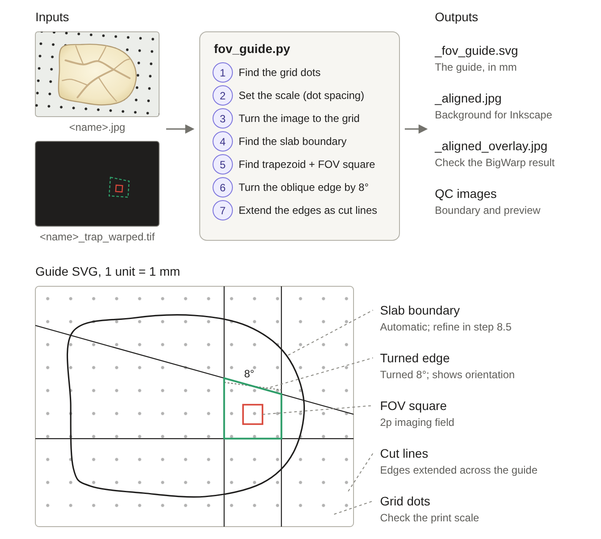
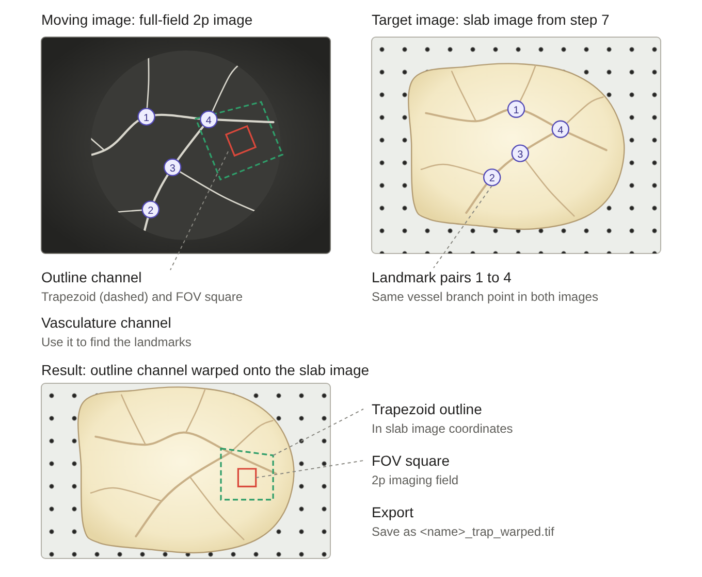
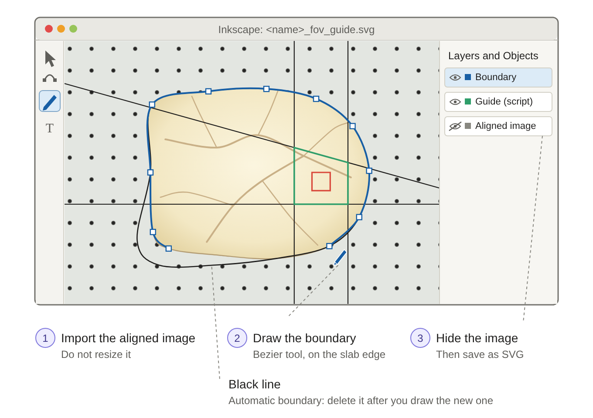

# fov-microdissection-guide

Make a 1:1 printable microdissection guide that shows where the in vivo two-photon (2p) field of view (FOV) is on a tangential brain slab.

This tool supports step 8, "Make Microdissection Guide", of the protocol *Tangential Sectioning and Microdissection of Perfused Mouse Brains Following in vivo 2-Photon Calcium Imaging*.



## What it does

1. Finds the dots of the printed sizing guide in the slab image. It calculates the pixel size from the dot spacing and turns the image so the grid is horizontal.
2. Finds the slab boundary automatically. This is a first pass that you refine in Inkscape.
3. Reads the BigWarp output (the FOV outlines warped onto the slab image). For each channel, it finds the trapezoid outline and the FOV square in it.
4. Turns the most oblique edge of the trapezoid by a set angle (default 8°). The two adjacent edges keep their directions, so parallel edges stay parallel and a 90° corner stays 90°. This makes the block asymmetric, so you can see its orientation after the cut.
5. Extends each trapezoid edge as a straight cut line across the whole guide (black, 0.176 mm = 0.5 pt), as in the guide template.
6. Writes an SVG at true size (1 SVG unit = 1 mm), and an aligned image of the slab that imports into Inkscape at the same size.

## Install

Python 3.9 or later.

```bash
git clone https://github.com/omidzobeiri/fov-microdissection-guide.git
cd fov-microdissection-guide
pip install -r requirements.txt
```

## Input

Put these two files in one session folder:

| File | Content |
| --- | --- |
| `<name>.jpg` | Stereo-microscope image of the slab on the dotted sizing guide (protocol step 7). |
| `<name>_trap_warped.tif` | BigWarp export of the moving image, warped into the slab image coordinates. Each outline channel holds one FOV square and the trapezoid outline around it. Other channels (for example the vasculature) can be in the file; select the outline channels with `--channels`. |

### Make the warped TIFF in BigWarp (Fiji)

1. Open the full-field 2p vasculature image (with its FOV channels) and the slab image.
2. Start BigWarp. Set the full-field image as the **moving** image and the slab image as the **target** image.
3. Put landmark pairs on the same surface-vessel features in the two images.
4. Export the warped moving image to the session folder with a name that ends in `_trap_warped.tif`.



## Run

```bash
python fov_guide.py /path/to/session_folder --dot-spacing-mm 0.93
```

If you do not give a folder, a folder dialog opens. You can also give the files directly:

```bash
python fov_guide.py --image slab.jpg --warped slab_trap_warped.tif -o guide.svg
```

### Parameters

| Option | Default | Effect |
| --- | --- | --- |
| `--dot-spacing-mm` | 0.93 | Measured distance between dots on **your printed** sizing guide (mm). Printers do not always print at exactly 100%, so measure it. |
| `--area-scale` | 1.0 | Scale of the trapezoid area about its center. |
| `--width-scale` | 1.0 | Scale across the two parallel edges of the trapezoid only. |
| `--angle-increase-deg` | 8.0 | Extra rotation of the most oblique trapezoid edge. |
| `--edge-extend-factor` | 0 | 0 = cut lines across the whole guide. A value > 0 gives shorter lines, as a multiple of the edge length. |
| `--cut-color` | black | Color of the cut lines. |
| `--cut-width-mm` | 0.176 | Width of the cut lines (0.5 pt). |
| `--brain-smooth-sigma` | 0.012 | Smoothing of the automatic slab boundary. |
| `--channels` | all | 0-based TIFF channels that hold FOV outlines, for example `--channels 1`. |
| `--no-plot` | off | Do not write the QC images. |

## Output

| File | Use |
| --- | --- |
| `<folder>_fov_guide.svg` | The guide, in mm. Open it in Inkscape. |
| `<folder>_fov_guide_aligned.jpg` | Slab image at the same scale and rotation as the SVG. Use it as the background to draw the slab boundary. |
| `<folder>_fov_guide_aligned_overlay.jpg` | Aligned image with the warped outlines. Use it to check the BigWarp alignment. |
| `brain_boundary_overlay.png` | QC: automatic boundary on the original image. |
| `svg_preview.png` | QC: preview of the guide. |

The SVG elements have IDs (`brain-boundary`, `ch<N>-trapezoid-fov`, `ch<N>-square-roi`, `ch<N>-trap-edge-<i>`, `grid-dots`), so you can find and edit them in the Inkscape XML editor.

## After the script

1. Open the SVG in Inkscape. Import `_aligned.jpg` (File > Import). In the import dialog, set Image DPI to "From file". Do not resize the image.
2. Set the units to mm and set the image position to X = 0, Y = 0. The image then has the same position, scale and orientation as the guide. Move it to the bottom (Object > Lower to Bottom).
3. With the Bezier tool, draw the slab boundary along the slab edge. Delete the automatic boundary (black line).
4. Hide or delete the image and save as SVG.
5. Insert the SVG into the Word sticker-paper template at 100% size, and print at 100% scale (protocol step 9).



## Example data

`examples/850399/` holds one real session (mouse 850399):

* `IMG_20260901_153457_850399.jpg`: slab on the sizing guide.
* `multiplane-ophys_850399_2026-07-28_10-32-20_trap_warped.tif`: BigWarp output with 2 channels. Channel 0 is the warped full-field vasculature. Channel 1 is the trapezoid outline and the FOV square.

```bash
python fov_guide.py examples/850399 --channels 1
```

Use `--channels` to select the outline channels. If a channel holds an image (for example the warped vasculature), the script can find a false trapezoid in it. The script gives a warning when a channel has more than 5% non-zero pixels.

Note: the example image is 2576 × 1932 px and the TIFF is 2592 × 1944 px (0.6% smaller image, because the image was re-saved). For your own data, use the original image that you used as the BigWarp target, so the two sizes are the same.

## Try it without data

```bash
python examples/make_synthetic_session.py demo_session
python fov_guide.py demo_session
```

## Test

```bash
pip install pytest
pytest
```

## License

MIT. See [LICENSE](LICENSE).
